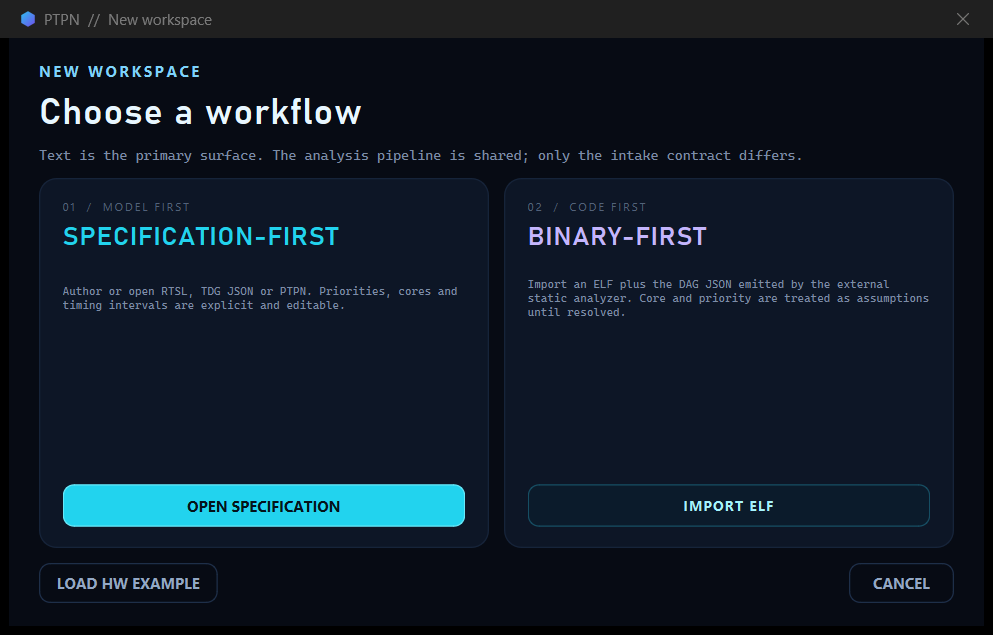
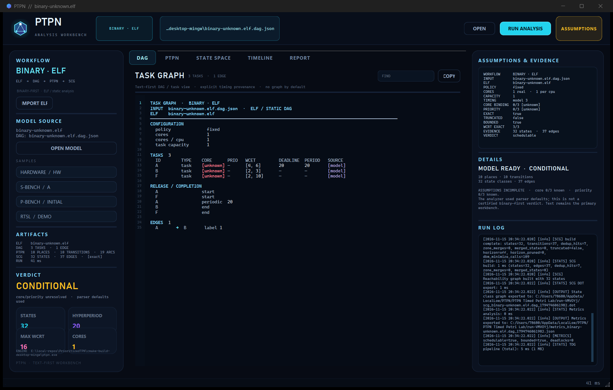

# PTPN Desktop


A Qt 6 Widgets workbench for the PTPN analyzer. The workbench is **text-first**:
the intermediate representations are dense, searchable, copyable text, and the
graph views are secondary previews opened on demand.

It runs the `ptpn` CLI as a child process and presents five stages:

- **DAG** — tasks, timing provenance, release/periodic bindings and TDG edges;
- **PTPN** — places, transitions, arcs, task lanes and the initial marking;
- **STATE SPACE** — state classes, markings, active/suspended sets and edges;
- **TIMELINE** — textual WCRT/WCET response envelopes per core;
- **REPORT** — a copyable analysis report with the assumptions and evidence.

Every stage has `FIND`, `COPY`, and — for PTPN and STATE SPACE — `PREVIEW`.
`PREVIEW` opens the interactive graph only when requested. The right-hand panel
always shows the assumptions behind the result: policy, cores, timing
provenance, core/priority coverage, exactness, truncation and evidence counts.


## Workflows



On first launch the workbench asks for an intake contract instead of silently
opening a demo. `NEW WORKSPACE` reopens the chooser later.

### Specification-first

```text
RTSL / TDG JSON / PTPN
        ↓
      DAG text
        ↓
      PTPN text
        ↓
      SCG text  →  timeline / report
```

RTSL inputs ask the analyzer to materialize the lowered TDG with
`--export-tdg`; TDG JSON inputs are shown directly. PTPN inputs have no DAG, so
the DAG stage reconstructs a task snapshot from metrics and explains that in the
text.

### Binary-first



The desktop app does **not** parse ELF in-process. It consumes the DAG produced
by an external static analyzer, using the sidecar contract:

```text
firmware.elf
firmware.elf.dag.json      ← TDG JSON emitted by the static analyzer
```

`IMPORT ELF` (or passing the `.elf` path on the command line) looks for
`<elf>.dag.json` / `<elf>.tdg.json` and falls back to `<basename>.dag.json`.
If the sidecar is missing, the app says so instead of fabricating a DAG.

Missing core/priority fields are kept as explicit assumptions. The analyzer may
still run with parser defaults for inspection, but the verdict becomes
**`CONDITIONAL` / `ASSUMPTIONS`**, the assumptions panel shows `core 0/N` and
`priority 0/N`, and the report says the result is not certified. This is
deliberately different from a green `SCHEDULABLE` with invented metadata.

The static analyzer itself is not bundled yet; the desktop adapter and the
sidecar contract are ready for it.


## Build

Prerequisites:

- CLion MinGW (GCC 15) or another x86_64 MinGW-w64;
- vcpkg at `D:\vcpkg`;
- Qt 6 Widgets installed once from the reduced manifest:

```bat
cd desktop
D:\vcpkg\vcpkg.exe install --triplet x64-mingw-dynamic ^
  --host-triplet x64-mingw-dynamic ^
  --x-install-root=D:\vcpkg\installed
```

`desktop/vcpkg.json` enables only `gui`, `widgets` and `png`; no QML, ICU,
OpenSSL or SQL.

> `windres` cannot handle spaces in the MinGW path. If CLion's MinGW lives under
> `E:\Jetbrains\CLion ...`, create a space-free junction first:
> `mklink /J D:\mingw64 "E:\Jetbrains\CLion 2026.1.2\bin\mingw"` and put
> `D:\mingw64\bin` on `PATH` for the Qt build.

From the repository root, with MinGW on `PATH`:

```bat
cmake --preset windows-desktop
cmake --build --preset windows-desktop --target ptpn_desktop
cmake-build-desktop-mingw\desktop\ptpn_desktop.exe
```

In CLion select the `windows-desktop` preset and the MinGW toolchain. The
`ptpn_desktop` target sits next to `ptpn` so the app can find the matching
analyzer through `PTPN_CLI_PATH`; `PTPN_BIN` and the usual build directories are
fallbacks.

The post-build step copies the Qt runtime, `qwindows.dll` and the MinGW runtime
next to the executable and next to the CLI, so the app also starts from Explorer.

## Preview graph


The graphs are the same views used before, now intentionally secondary. They
remain useful for spatial inspection, while the text pages are the default for
large models and precise reading.

## Notes

- With no file argument the app opens the workflow chooser. Pass a `.rtsl`,
  `.json`, `.ptpn` or `.elf` path on the command line to bypass it.
- Drop `.rtsl`, `.json` or `.ptpn` files onto the window.
- `Ctrl+1` … `Ctrl+5` switch stages; `Ctrl+P` opens the graph preview for the
  current PTPN/STATE SPACE page.
- Pending RTSL measurements are reported exactly as the analyzer reports them
  (`E-VAL-213`); the workbench does not invent timing values.
- The sidebar keeps artifact counts and a session run history; unresolved
  binary-first assumptions remain visible there and in the right-hand panel.
