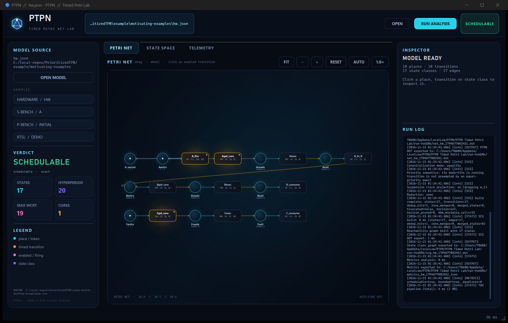
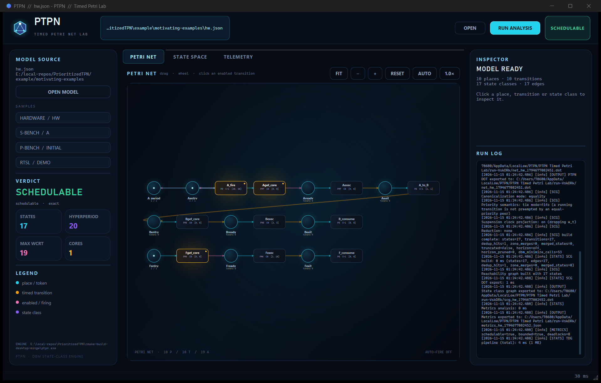

# PTPN Desktop



A Qt 6 Widgets front-end for the PTPN analyzer. It runs the `ptpn` CLI as a
child process, parses the analyzer's own exports, and renders:

- an interactive **Petri net** with places, timed transitions, tokens and
  firing animations. Click an enabled transition to fire it, or switch on
  auto-fire and watch the token game;
- the **state-class reachability graph** (SCG) exported by the analyzer, with
  marking/active-set inspection for every state;
- a **telemetry** page with schedulability, state counts, per-task
  WCET→WCRT/deadline envelopes, per-core utilization, and exactness flags.

The desktop app is optional and is not part of the CLI/CI build.

## Prerequisites

- The CLion MinGW toolchain (GCC 15) or another x86_64 MinGW-w64.
- vcpkg at `D:\vcpkg`.
- Qt 6 Widgets. Build the reduced `qtbase` port once:

```bat
cd desktop
D:\vcpkg\vcpkg.exe install --triplet x64-mingw-dynamic ^
  --host-triplet x64-mingw-dynamic ^
  --x-install-root=D:\vcpkg\installed
```

`desktop/vcpkg.json` enables only `gui`, `widgets` and `png`; this keeps the
Qt build small (no QML, ICU, OpenSSL or SQL).

> The `windres` tool shipped with MinGW cannot handle spaces in the compiler
> path. If CLion's MinGW lives under `E:\Jetbrains\CLion ...`, create a
> space-free junction first: `mklink /J D:\mingw64 "E:\Jetbrains\CLion
> 2026.1.2\bin\mingw"` and put `D:\mingw64\bin` on `PATH` for the Qt build.

## Build

From the repository root, with `D:\mingw64\bin` (or CLion's MinGW `bin`) on
`PATH`:

```bat
cmake --preset windows-desktop
cmake --build --preset windows-desktop
```

The preset enables `PTPN_BUILD_DESKTOP`, uses `cmake-build-desktop-mingw`, and
finds Qt through `D:/vcpkg/installed/x64-mingw-dynamic`. In CLion select the
`windows-desktop` preset and the MinGW toolchain; the `ptpn_desktop` target sits
next to `ptpn` so the app can always find the matching analyzer binary.

Run:

```bat
cmake-build-desktop-mingw\ptpn_desktop.exe
```

The post-build step copies the Qt runtime, `qwindows.dll`, and the MinGW runtime
next to the executable, so it also starts from Explorer. The analyzer CLI is
located via `PTPN_CLI_PATH` (the built `ptpn` target), `PTPN_BIN`, or the usual
`cmake-build-*` locations.

## Notes

- The app auto-loads `example/motivating-examples/hw.json` on startup.
- Drop `.rtsl`, `.json` or `.ptpn` files onto the window to analyze them.
- If a model needs `core any`, use `ptpn allocate`; the desktop app reports the
  analyzer's unsupported-class diagnostic.


