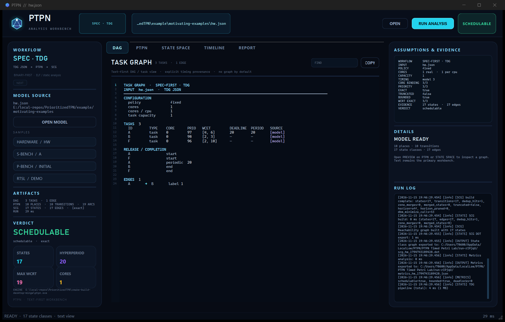
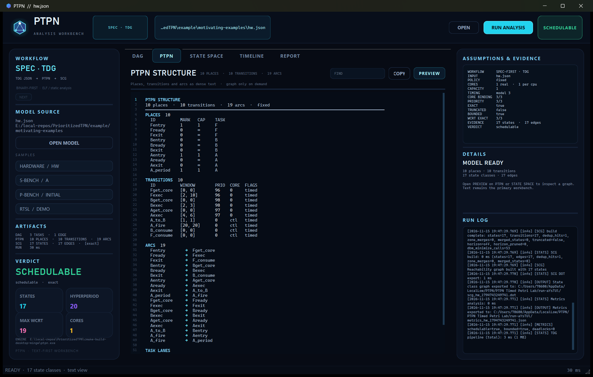
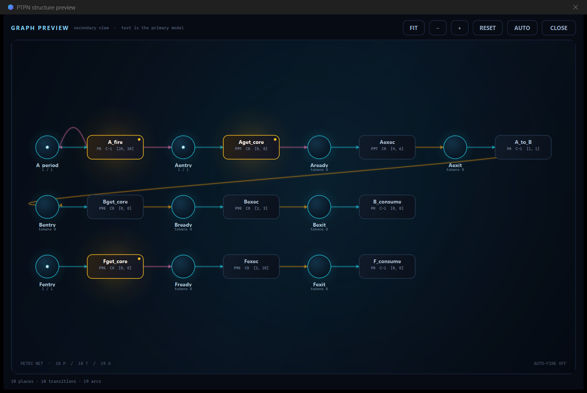

# PTPN Desktop



A Qt 6 Widgets workbench for the PTPN analyzer. The workbench is **text-first**:
the intermediate representations are dense, searchable, copyable text, and the
graph views are secondary previews opened on demand.

It runs the `ptpn` CLI as a child process and presents five stages:

- **DAG** — tasks, timing provenance, release/periodic bindings and TDG edges;
- **PTPN** — places, transitions, arcs, task lanes and the initial marking;
- **STATE SPACE** — state classes, markings, active/suspended sets and edges;
- **TIMELINE** — textual WCRT/WCET response envelopes per core;
- **REPORT** — a copyable analysis report with the assumptions and evidence.

Every stage has `FIND`, `COPY`, and — for PTPN and STATE SPACE — `PREVIEW`.
`PREVIEW` opens the interactive graph only when requested. The right-hand panel
always shows the assumptions behind the result: policy, cores, timing
provenance, core/priority coverage, exactness, truncation and evidence counts.



## Workflows

The current phase implements the **specification-first** path:

```text
RTSL / TDG JSON / PTPN
        ↓
      DAG text
        ↓
      PTPN text
        ↓
      SCG text  →  timeline / report
```

RTSL inputs ask the analyzer to materialize the lowered TDG with
`--export-tdg`; TDG JSON inputs are shown directly. PTPN inputs have no DAG, so
the DAG stage reconstructs a task snapshot from metrics and explains that in the
text. The **binary-first** path (ELF / static analysis → DAG) is represented in
the workflow panel as the next stage; the backend adapter is not wired yet.

## Build

Prerequisites:

- CLion MinGW (GCC 15) or another x86_64 MinGW-w64;
- vcpkg at `D:\vcpkg`;
- Qt 6 Widgets installed once from the reduced manifest:

```bat
cd desktop
D:\vcpkg\vcpkg.exe install --triplet x64-mingw-dynamic ^
  --host-triplet x64-mingw-dynamic ^
  --x-install-root=D:\vcpkg\installed
```

`desktop/vcpkg.json` enables only `gui`, `widgets` and `png`; no QML, ICU,
OpenSSL or SQL.

> `windres` cannot handle spaces in the MinGW path. If CLion's MinGW lives under
> `E:\Jetbrains\CLion ...`, create a space-free junction first:
> `mklink /J D:\mingw64 "E:\Jetbrains\CLion 2026.1.2\bin\mingw"` and put
> `D:\mingw64\bin` on `PATH` for the Qt build.

From the repository root, with MinGW on `PATH`:

```bat
cmake --preset windows-desktop
cmake --build --preset windows-desktop --target ptpn_desktop
cmake-build-desktop-mingw\desktop\ptpn_desktop.exe
```

In CLion select the `windows-desktop` preset and the MinGW toolchain. The
`ptpn_desktop` target sits next to `ptpn` so the app can find the matching
analyzer through `PTPN_CLI_PATH`; `PTPN_BIN` and the usual build directories are
fallbacks.

The post-build step copies the Qt runtime, `qwindows.dll` and the MinGW runtime
next to the executable and next to the CLI, so the app also starts from Explorer.

## Preview graph



The graphs are the same views used before, now intentionally secondary. They
remain useful for spatial inspection, while the text pages are the default for
large models and precise reading.

## Notes

- On startup the app loads `example/motivating-examples/hw.json` when no file
  argument is given. Pass a file path on the command line to open it directly.
- Drop `.rtsl`, `.json` or `.ptpn` files onto the window.
- `Ctrl+1` … `Ctrl+5` switch stages; `Ctrl+P` opens the graph preview for the
  current PTPN/STATE SPACE page.
- Pending RTSL measurements are reported exactly as the analyzer reports them
  (`E-VAL-213`); the workbench does not invent timing values.
- `binary-first` (ELF / static analysis) is the next workflow; the current UI
  keeps it visible but does not claim support.
