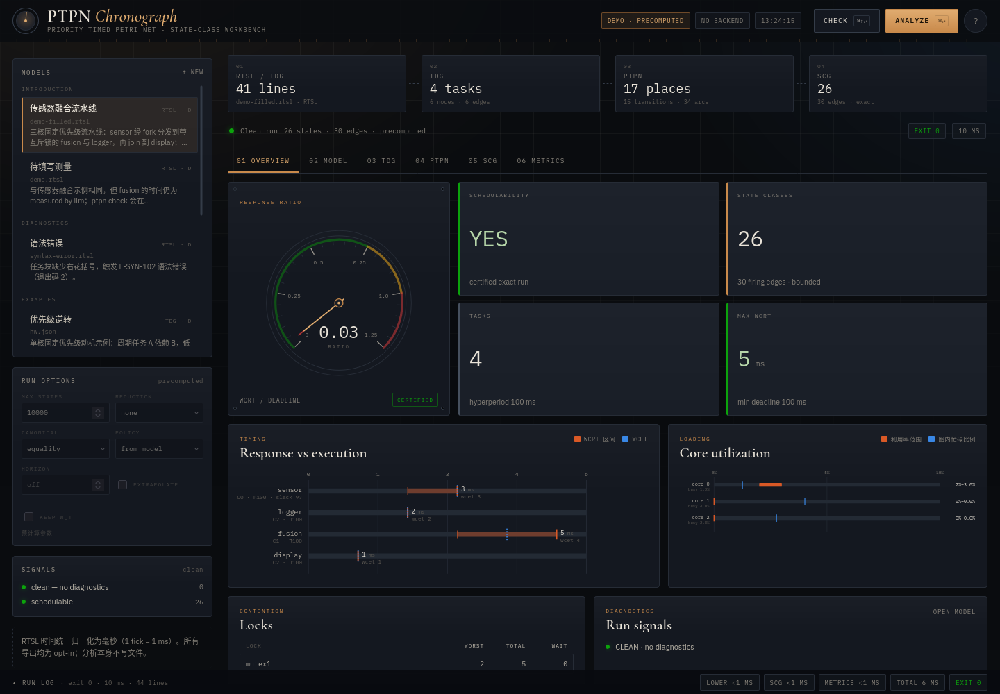

# PTPN Web UI 后端



本地 Web 界面，用浏览器浏览和运行 PTPN 分析。后端是一个**零第三方依赖**的
Python 3.9+ 标准库 HTTP 服务（`ThreadingHTTPServer`），把现有的命令行程序
`build/ptpn` 包装成结构化 JSON API；前端是 `webapp/static/` 下的静态文件。

```
浏览器  ──HTTP──▶  webapp/server.py  ──argv──▶  build/ptpn
                          │                         │
                          └── temp dir：model.rtsl / model.json
                              TDG / PTPN / SCG / metrics / WCET 导出
```

## 环境要求

- Python 3.9 或更新版本（只用标准库，无需 `pip install`）。
- 已构建的 PTPN 分析器：`build/ptpn`（见仓库根目录 `CLAUDE.md` 的构建说明）。
- Graphviz（可选）：PTPN 图用 `dot`、SCG 图用 `neato` 计算布局；缺少
  `neato` 时回退到 `dot`。没有 Graphviz 时 API 仍可用，图会返回节点/边但
  `"layout": "none"`，并给出 notice。
- 现代浏览器。

## 启动

```bash
python3 webapp/server.py
```

默认监听 `127.0.0.1:8765`，打印 URL 并自动打开浏览器。按 `Ctrl+C` 退出。

```bash
python3 webapp/server.py --port 8799 --no-browser   # 测试 / 无头环境
python3 webapp/server.py --demo                      # 预计算演示模式
python3 webapp/build_standalone.py                   # 单文件演示页（可双击/分享）
```

| 参数 | 默认值 | 说明 |
|---|---|---|
| `--host HOST` | `127.0.0.1` | 绑定地址。请保持 localhost，见“安全说明”。 |
| `--port PORT` | `8765` | 监听端口；传 `0` 可让系统分配。 |
| `--no-browser` | 关闭 | 不自动打开浏览器。 |
| `--demo` | 关闭 | 让 `/demo-data.js`、`/static/demo-data.js` 优先指向生成的 `webapp/demo/demo-data.js`；缺失时回退到 `webapp/static/demo-data.js` 占位文件。 |

`--demo` 下 `/api/*` 仍会实时调用分析器；生成的 demo 数据只影响前端首屏和
Artifact 演示，不会改变 API 行为。

### 前端

`webapp/static/` 是一个无构建步骤的单页工作台（原生 HTML/CSS/JS）：

- 左侧模型列表与运行选项（max states、canonicalization、reduction、policy、horizon、extrapolation）。
- `Model` 标签页：RTSL/TDG 语法高亮编辑器、诊断行标记、pending measurement 一键填写。
- `TDG` / `PTPN` / `SCG` 标签页：可缩放拖动的交互图；PTPN 默认聚焦首段执行链，`FIT` 查看全网。
- `Overview`：WCRT/WCET 包络、核利用率、响应比仪表盘、锁与诊断摘要。
- `Metrics`：完整 per-task 时序表、核/锁表、全局事实与 JSON 复制。
- 底部 `RUN LOG` 抽屉显示分析器 stderr 与 `[STATS]` 时序。

视觉上采用石墨黑 + 铜琥珀 + 冷青的“精密时计”仪表风格；图表配色经过
dataviz 校验，状态色与序列色分离。移动端提供 `☰` 模型抽屉。

### 前端文件约定

- `GET /` 读取 `webapp/static/index.html`。该文件是**不含
  `<!doctype>/<html>/<head>/<body>` 的片段**，服务器会包装成完整文档后再返回：

  ```html
  <!doctype html><html><head><meta charset="utf-8">
  <meta name="viewport" content="width=device-width, initial-scale=1, viewport-fit=cover">
  </head><body> …片段… </body></html>
  ```

- 页面中的相对引用 `style.css`、`app.js`、`demo-data.js` 会从
  `webapp/static/`（`--demo` 时优先 `webapp/demo/`）解析，因此根路径
  `/style.css` 等也可以直接访问。
- `webapp/static/demo-data.js` 是普通的空占位文件，由静态处理器按正常
  MIME 提供；生产/Artifact 演示数据由 `webapp/demo/demo-data.js` 提供。
- API 和 HTML 响应都带 `Cache-Control: no-store`。

## 二进制发现顺序

1. 环境变量 `PTPN_BIN`（相对路径按仓库根目录解析）。
2. 仓库根目录的 `.ptpn-build-dir` 文件内容作为构建目录，使用 `<dir>/ptpn`。
   若该二进制不存在，则回退到第 3 条。
3. `build/ptpn`。

可通过 `DOT_BIN` 指定 Graphviz 可执行文件（默认使用 `PATH` 中的 `dot`；
`neato` 会在同一目录或 `PATH` 中查找）。
`GET /api/status` 会报告最终选中的二进制、版本、Graphviz 版本和是否存在；
缺失时 `binary_exists` 为 `false` 并附带 `binary_error`，分析请求返回 HTTP 503。

## JSON API

所有响应为 UTF-8 JSON；错误响应形如 `{"ok": false, "error": "..."}`。

### `GET /api/status`

```json
{
  "ok": true,
  "demo": false,
  "binary": "/repo/build/ptpn",
  "binary_exists": true,
  "version": "1.0.0",
  "graphviz": "13.0.1",
  "repo_root": "/repo",
  "build_dir": "build"
}
```

### `GET /api/examples`

`{"examples": [ … ]}`，只包含磁盘上实际存在的示例。每个对象：

```json
{
  "id": "intro-demo",
  "name": "demo-filled.rtsl",
  "title": "传感器融合流水线",
  "kind": "rtsl",                     // rtsl | tdg
  "path": "example/introduction/demo-filled.rtsl",
  "source": "…文件全文…",
  "description": "…",
  "tags": ["RTSL", "fork/join"],
  "demo": true,
  "options": { "max_states": 10000, "canonicalization": "equality",
               "reduction": "none", "policy": "", "horizon": null,
               "extrapolation": false, "keep_suspension_clocks": false }
}
```

示例 `deadlock` 额外带有 `"render_limit": 500`，`symmetry-4` 的
`reduction` 为 `"symmetry"`，`pipeline-20` 的 `max_states` 为 `20000`。

### `POST /api/analyze`

请求体：

```json
{
  "source": "system demo { … }",
  "filename": "model.rtsl",
  "kind": "rtsl",
  "mode": "analyze",
  "options": {
    "max_states": 10000,
    "canonicalization": "equality",
    "reduction": "none",
    "policy": "",
    "horizon": null,
    "extrapolation": false,
    "keep_suspension_clocks": false,
    "render_limit": 1800
  }
}
```

- `source`：必填字符串，UTF-8 最多 2 MB。**不接受文件路径**；服务器总是把它
  写到临时目录中的 `model.rtsl` / `model.json`。
- `kind`：`rtsl` 或 `tdg`；缺省按 `filename` 后缀推断。
- `mode`：`check`（仅 RTSL，执行 `ptpn check`）或 `analyze`（默认）。
- `options`：白名单字段；未知字段直接返回 HTTP 400。
  - `max_states`：1–200000，默认 10000。
  - `canonicalization`：`equality` | `max-lower` | `intersection`。
  - `reduction`：`none` | `upper-bound` | `cone` | `symmetry`。
  - `policy`：策略名（非空时才传给 CLI）。
  - `horizon`：非负整数或 `null`。
  - `extrapolation`、`keep_suspension_clocks`：布尔值。
  - `render_limit`：图渲染节点上限，默认 1800；超过时跳过布局。

成功完成一次分析（无论 `ptpn` 退出码是什么）都返回 HTTP 200。响应字段：

```json
{
  "ok": false,                       // 仅当 exit_code == 0 时为 true
  "exit_code": 6,                    // ptpn 退出码；超时为 124
  "duration_ms": 88,
  "diagnostics": [ … ],              // 诊断 envelope 的 diagnostics 数组
  "envelope": { … } | null,          // 原始 ptpn 诊断 envelope
  "analysis": { … } | null,          // envelope.result.analysis
  "pending_measurements": [ … ],     // envelope.result.pending_measurements 或 []
  "metrics": { … } | null,           // --export-metrics 的 JSON
  "wcet": { … } | null,              // --export-wcet 的 JSON
  "tdg": { … } | null,               // RTSL：导出的 TDG；TDG：解析后的请求源
  "graphs": { "ptpn": { … } | null, "scg": { … } | null },
  "timings": { "lowering_ms": 0, "scg_ms": 11,
               "metrics_ms": 4, "total_ms": 59 },
  "logs": ["…stderr 最后 300 行，已去除 ANSI…"],
  "effective_options": { … },
  "notices": ["…图被截断、缺少 dot、超时等提示…"]
}
```

诊断中的 `location.file`（以及 `pending_measurements[].inject.file`）会从临时
路径改写为客户端提供的 `filename`。

**退出码**：`0` 成功；`2` 语法错误；`3` 校验错误；`4` 不支持类；`5` 部分结果
（截断且无运行时反例）；`6` 已证实的死锁 / 截止期反例（**仍是有效分析**，
`metrics` 通常存在，但 `ok=false`）；`105` 是 CLI11 参数错误（无 envelope，
notice 中会说明）；`124` 是服务器 180 秒超时并已 kill 进程。

HTTP 层错误：`400` 请求/选项非法，`411` 缺少 `Content-Length`，`413` 请求体
超过 4 MB，`503` 找不到可执行的 `ptpn`，`500` 服务器内部错误。

### 图（`graphs`）结构

```json
{
  "nodes": [
    {
      "id": "sensorexec", "kind": "exec", "text": "sensorexec",
      "tooltip": null, "raw_label": "sensorexec\n(core=0, π=100)\nI=[[2, 3]",
      "core": 0, "priority": 100, "interval": [2, 3],
      "x": 693.93, "y": 226.88, "w": 111.13, "h": 61.92
    }
  ],
  "edges": [
    { "from": "sensorentry", "to": "sensorget_core",
      "label": "", "tooltip": null,
      "points": [[211.11, 226.88], …] }
  ],
  "bb": { "w": 3966.2, "h": 510.45 },
  "truncated": false,
  "node_count": 32,
  "edge_count": 34,
  "layout": "neato"
}
```

- 坐标单位是 **point（pt）**，原点在左上角（已按 `bb` 高度翻转 y）。
- PTPN 节点：`circle` 为 place（附加 `marking`、`capacity`），`box` 为
  transition（附加 `core`、`priority`、`interval`）；`kind` 取值
  `place/period/resource/hold/segment/exec/acquire/lock/fork/join/control/transition`。
- SCG 节点：`label` 为 `S<n>`，`kind` 为 `state`；当
  `metrics.deadlock_states` 包含该状态编号时 `kind` 为 `deadlock`，并始终带有
  布尔字段 `deadlock`。`detail` 从 tooltip 解析：
  `{elapsed, marking, enabled, suspended, zone}`。
- SCG 边从 label 解析 `transition`、`core`、`dwell_min/max`、`at_min/max`。
- `edge.points` 按 tail → head 排列，已去掉 Graphviz 的 `e,`/`s,` 标记点。
- 节点数超过 `render_limit` 时跳过布局：`nodes`/`edges` 为空、
  `"truncated": true`、`"layout": "none"`，并追加 notice。
- Graphviz 失败时返回解析出的节点/边（无坐标）、`"layout": "none"` 和 notice。

## 重新生成演示数据

```bash
python3 webapp/make_demo.py
```

该脚本导入 `server.run_analysis`（不启动 HTTP 服务），用每个示例的推荐选项
运行全部 `"demo": true` 的示例，并写入 `webapp/demo/demo-data.js`：

```js
window.PTPN_DEMO_DATA = {
  "generated_at": "2026-10-20T05:06:07Z",
  "status": { … /api/status 的内容（demo=true）… },
  "examples": [ { …示例字段…, "source": "…", "response": { … } } ]
};
```

- 生成文件当前约 1.6 MB，硬上限 8 MB；超过时脚本报错且不写文件。
- 所有 `</` 都转义为 `<\/`，因此可以安全嵌入 HTML；`</script>` 不会出现。
- 脚本会打印每个示例的退出码、状态数、metrics 是否存在、SCG/PTPN 节点/边数
  和该示例响应的字节数。
- 可用 `python3 webapp/make_demo.py OUTPUT_PATH` 写到其他位置。
- 生成单文件、无需服务器的演示页：
  `python3 webapp/build_standalone.py` →
  `webapp/demo/ptpn-chronograph-demo.html`（内联 CSS/JS/预计算数据，可直接用
  浏览器打开或发给别人；Google Fonts 不可用时回退到系统字体）。
- 校验：`node --check webapp/demo/demo-data.js`。
- 演示数据只针对演示示例生成；`--demo` 页面缺少 `webapp/demo/demo-data.js`
  时会回退到 `webapp/static/demo-data.js` 的空占位文件（前端随后走实时 API）。

## 安全说明

- 服务默认只绑定 `127.0.0.1`，**没有认证**。不要用 `--host 0.0.0.0` 暴露到
  网络或公网。
- 提交的源码会交给分析器解析（分析器本身处理不可信输入），但**不会经过
  shell**：服务器用参数数组调用 `subprocess`，客户端无法注入命令。
- 客户端不能提供文件路径；源码只写入新建的临时目录，文件名固定为
  `model.rtsl`/`model.json`。
- 每次请求的 TDG、PTPN DOT、SCG DOT、metrics、WCET 导出都是该临时目录中的
  临时文件，请求结束（包括超时/异常）后递归删除。
- 请求体上限 4 MB、源码上限 2 MB、分析超时 180 秒、DOT 布局超时 60 秒。
- 静态文件处理器解析真实路径并做 `commonpath` 检查，拒绝 `..`、反斜杠和
  指向目录外的符号链接。
